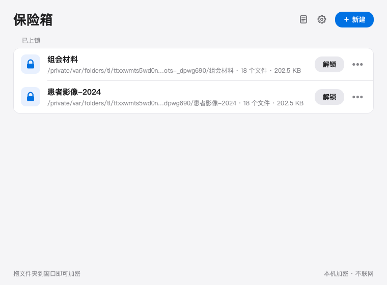
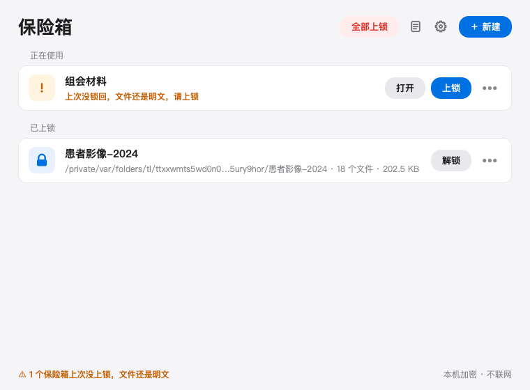
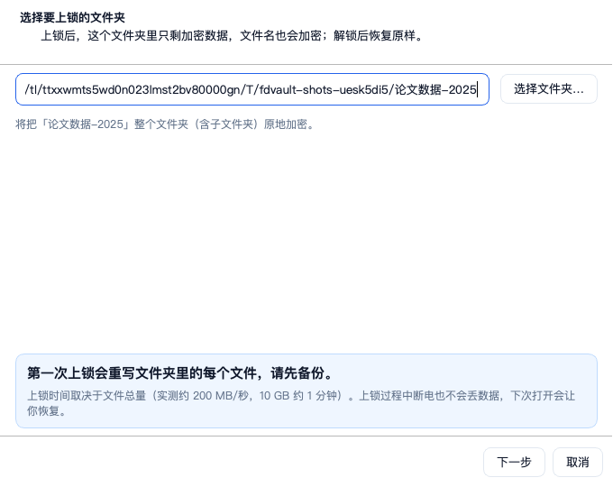
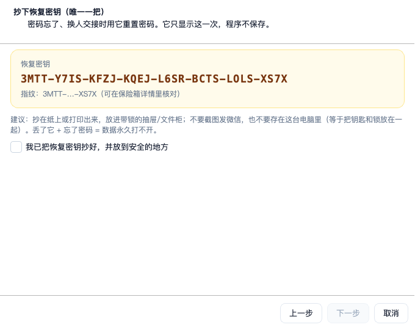
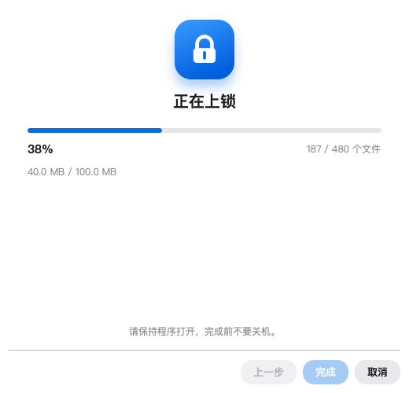
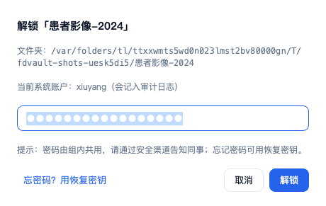
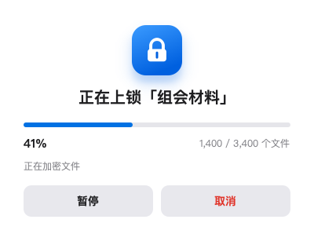
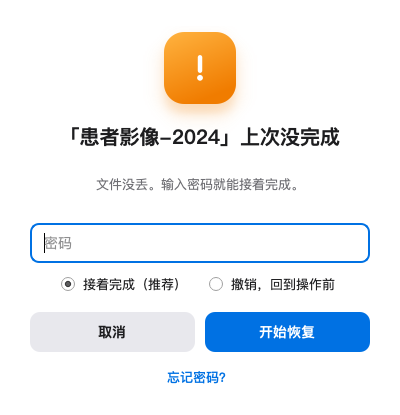
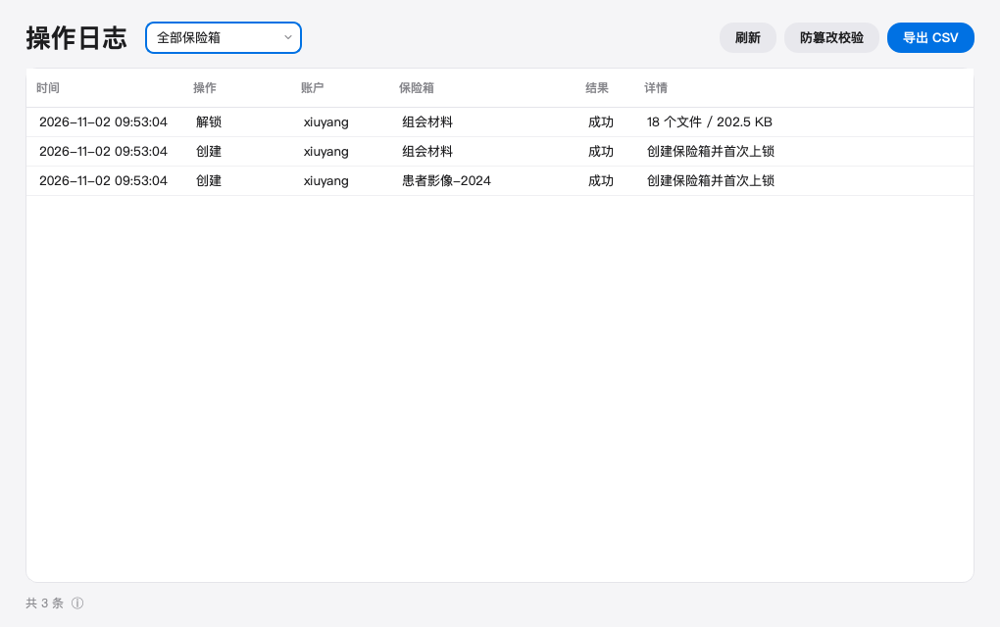
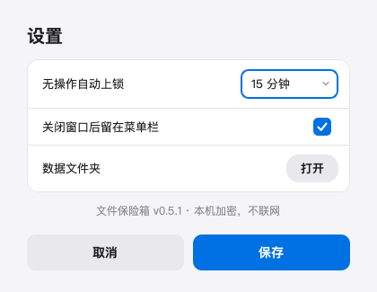

# 文件保险箱（工作名）

跨平台文件夹加密工具，给组里 2–5 人共用电脑保护敏感数据（患者隐私 / 伦理审查场景）。
**Windows + macOS**：输密码原地解锁、用完一键锁回，带审计日志、恢复密钥和自动上锁。

## 当前状态

| 阶段 | 状态 |
|---|---|
| 需求确认 v0.2 | ✅ 已完成（7 项决定全部确认） |
| **M1 加密核心 + 命令行 + 断电测试** | ✅ **已完成（macOS 实测通过）** |
| **M2 macOS 图形界面 + 托盘 + 自动上锁 + 恢复向导 + 审计界面** | ✅ **已完成（离屏自检 18 项全过）** |
| M3 打包 + CI + 真机联调 | 🚧 **进行中**：macOS 三个产物（zip / dmg / 源码包）已产出，打包版自检 6 项 + 冒烟（含文件夹参数入口）通过；Windows 打包脚本、右键菜单、一键验收自检脚本、CI 已就绪，待 Windows 真机验证 |
| M4 入口 + 使用文档 + 验收 | 🚧 **进行中**：拖拽/命令行/Finder 快速操作入口、退出自动上锁检查、不联网静态检查、使用说明、验收清单、100 次循环残留测试已完成；真实数据试点待用户 |

已完成部分的结论：

- **加密与断电恢复**：136 个自动化测试 + 21 种强制断电场景 + 120 次随机杀进程压力测试全部通过，
  恢复后数据 **0 字节丢失**（见 [测试报告 M1](docs/测试报告-M1.md)）。
- **图形界面**：新建向导 → 首次上锁 → 解锁 → 上锁 → 恢复 → 审计全流程跑通；
  18 项 GUI 自检全过（见 [测试报告 M2](docs/测试报告-M2.md)）。

## 这些文件先看

| 文件 | 内容 | 给谁看 |
|---|---|---|
| [需求说明书](docs/需求说明书.md) | 需求、界面、验收标准、风险 | **组里同事看这个** |
| [界面草图](docs/界面草图.html) | 浏览器打开，13 个界面可点击（设计稿） | **组里同事点这个** |
| [界面实拍](docs/images/gui/) | 14 张真实界面截图（M2 已完成） | 组里同事 / 你 |
| [使用说明](docs/使用说明.md) | 安装、建保险箱、日常解锁上锁、忘密码怎么办 | **组里同事看这个** |
| [验收清单](docs/验收清单.md) | 需求 13 条逐条验证结果 + 手动验收步骤 | 你 / 导师 |
| [验收记录表](docs/验收记录表.md) | 打印/填写用：自动检查 + 13 条 + 14 步手工验收 + 签字 | 你 / 导师 |
| [发布说明 0.3.0](docs/发布说明-0.3.0.md) | 这一版能做什么、安全设计、已知限制、验证概况 | 组里同事 / 导师 |
| [常见问题与报错](docs/常见问题与报错.md) | 安装/密码/上锁解锁/数据安全/日志，按原文对照处理 | 组里所有人 |
| [试点方案](docs/试点方案.md) | 用脱敏数据试点的范围、7 天步骤、出错处理、成功标准 | 你 / 试点同事 |
| [Windows 真机联调记录](docs/Windows真机联调记录.md) | 22 步 Windows 验收清单 + 日志收集 + 问题反馈模板 | 你 / Windows 测试同事 |
| [macOS 真机检查记录](docs/macOS真机检查记录.md) | 19 步 macOS 菜单栏/自动上锁/快速操作/多账户检查清单 | 你 |
| [测试报告（M1）](docs/测试报告-M1.md) | 加密核心测了什么、结果、怎么复现 | 你 / 导师 |
| [测试报告（M2）](docs/测试报告-M2.md) | 图形界面测了什么、截图、未验证项 | 你 / 导师 |
| [技术方案](docs/技术方案.md) | 加密格式、断电恢复、平台实现 | 实现用 |
| [技术调研备忘](docs/参考-技术调研.md) | 跨平台方案对比与来源 | 备查 |

## 先在本机试一下（macOS）

```bash
cd 文件保险箱

# 1. 建环境（用你机器上的 python3，3.12+）
python3 -m venv .venv
.venv/bin/pip install -r requirements.txt -r requirements-dev.txt

# 2. 跑测试（看全部通过；本机跳过 3 项 Windows 专用检查）
.venv/bin/python -m pytest tests -q
.venv/bin/python scripts/gui_selftest.py     # 图形界面 18 项自检

# 3. 命令行版：拿一个测试文件夹试真实流程
mkdir -p /tmp/测试保险箱 && echo "机密内容" > /tmp/测试保险箱/患者名单.txt
.venv/bin/python -m cli.main create /tmp/测试保险箱
#   ↑ 会让你输两次密码，打印一串恢复密钥（抄下来！）
.venv/bin/python -m cli.main unlock /tmp/测试保险箱
.venv/bin/python -m cli.main lock   /tmp/测试保险箱
.venv/bin/python -m cli.main audit  --limit 20

# 4. 图形界面版
.venv/bin/python -m gui
```

图形界面第一次启动会做这些事：

1. 窗口列出已添加的保险箱（第一次是空的，点「新建保险箱」）。
2. 新建时分三步：选文件夹 → 设组内共用密码 → **抄下恢复密钥**；然后才真正加密（有进度条，可暂停/取消）。
3. 解锁后按钮变成「立即上锁」和「打开文件夹」；窗口显示"还有几分钟自动上锁"。
4. 关掉窗口默认缩小到托盘/菜单栏；托盘菜单里有「立即上锁全部」。
5. 「审计日志」窗口能按保险箱筛选、导出 CSV、一键校验日志有没有被改过。

> 同一个人不要在命令行和图形界面里同时操作同一个保险箱：加密核心有跨进程文件锁会拦住，
> 但图形界面会提示"另一个窗口正在操作"，等对方结束再试即可。
> 审计日志默认写到 `~/Library/Application Support/文件保险箱/audit.jsonl`。

## 界面实拍（M2，真实截图）

这些是程序真实渲染的界面（离屏渲染导出，不是设计稿）：

| 主界面：刚打开，全部已上锁 | 主界面：解锁后显示自动上锁倒计时 |
|---|---|
|  |  |

| 新建向导第 1 步：选文件夹 | 第 3 步：抄恢复密钥（唯一一把） |
|---|---|
|  |  |

| 首次上锁：带进度、可暂停/取消 | 解锁：输密码 |
|---|---|
|  |  |

| 上锁进度 | 恢复向导（上次中断时出现） |
|---|---|
|  |  |

| 审计日志：筛选 / 导出 / 校验哈希链 | 设置：自动上锁时间、关闭窗口行为 |
|---|---|
|  |  |

另有：低磁盘警告横幅 `01b-main-lowdisk.png`、托盘菜单 `09-tray-menu.png`、图标 `00-icons.png`，
都在 [docs/images/gui/](docs/images/gui/)。

> 设计稿与实拍的差别：设计稿有 13 张手绘草图；实拍已全部落地，只是真实界面更朴素
> （系统原生控件、没有插画），功能入口与草图一一对应。截图里的进度数字是抓拍时填的示意值。

## 安装包怎么拿到（M3）

安装包不放进代码仓库（`.app` 解压后约 280 MB，zip 约 40 MB，dmg 约 43 MB）。两种拿法：

1. **本机打**：项目根目录运行

   ```bash
   .venv/bin/python scripts/build_app.py
   ```

   产物在 `dist/`：
   - macOS：`文件保险箱-x.y.z-macOS-arm64.zip`（拖拽安装）、`...-macOS-arm64.dmg`（双击挂载，拖进 Applications）
   - Windows：`文件保险箱-x.y.z-Windows-x64.zip`
   - 通用：`文件保险箱-x.y.z-源码.zip`（源码 + 文档 + 测试 + CI，换电脑可复现）
   - `SHA256SUMS.txt` 列出三个产物的 sha256
   - 打包完成后脚本会自动运行 `文件保险箱 --acceptance`（默认 KDF/分块的真实参数验收）
     和 `--selftest`（组件自检），不通过就构建失败

2. **GitHub Actions 自动打**：本仓库的 `.github/workflows/build.yml`（单独推本目录时用），
   或组内私有仓库 `group-use` 的 `.github/workflows/build-vault.yml`（同时管两个子项目），
   每个平台自动跑 136 个测试 + 18 项 GUI 自检 + 打包，产物在 Actions 的 Artifacts / Releases 里。

安装说明（发给组里同事看）：

- macOS：[installers/macos/安装说明.md](installers/macos/安装说明.md)（含 Gatekeeper 首次打开、快速操作做法）
- Windows：[installers/windows/安装说明.md](installers/windows/安装说明.md)（含 SmartScreen、右键菜单、托盘）

> 真实签名的预算还没花：macOS 首次打开要右键→打开，Windows 会弹 SmartScreen，
> 点"更多信息→仍要运行"即可；组内自用可接受，M4 可在预算允许时补签名。

## 目录结构

```
文件保险箱/
├── core/             加密核心（无界面依赖，可单测）
│   ├── crypto.py     密码派生、密钥包装、恢复密钥
│   ├── header.py     .vault/header.json 读写
│   ├── manifest.py   SQLite 元数据（文件名加密）
│   ├── transform.py  单文件分块加解密
│   ├── vault.py      状态机：创建/解锁/上锁/恢复/校验
│   ├── control.py    暂停 / 取消 / 回滚
│   ├── fsutil.py     原子写、fsync、目录扫描
│   ├── lockfile.py   跨进程互斥锁
│   └── audit.py      审计日志（哈希链）
├── cli/              命令行
├── installers/       安装说明 / Windows 右键菜单脚本 / macOS 快速操作 .workflow
├── assets/           图标（由程序自动生成）
├── gui/              图形界面（PySide6）
│   ├── app.py        入口：单实例、托盘、主窗口
│   ├── main_window.py 保险箱列表、托盘菜单、自动上锁
│   ├── wizard.py     新建向导（选文件夹→密码→恢复密钥→首次上锁）
│   ├── dialogs.py    密码/恢复/进度/设置/审计窗口
│   ├── workers.py    后台线程、单实例
│   ├── selfcheck.py  打包自检（--selftest）
│   ├── store.py      界面配置、空闲时间检测
│   └── style.py      配色、控件样式、图标
├── tests/            136 个自动化测试（含断电注入）
├── scripts/          压力测试 / 性能测试 / GUI 自检 / 截图 / 打包
├── docs/             需求、技术方案、界面草图、测试报告、界面实拍
└── README.md
```

## 里程碑

- **M1**：加密核心 + 命令行 + 断电/崩溃测试（Mac 上跑通）✅
- **M2**：Mac GUI + 托盘 + 自动上锁 + 恢复向导 + 审计界面 ✅
- **M3**：打包 + GitHub Actions 自动构建 + 真机联调（macOS zip/dmg/源码包已出；Windows CI 已全绿、安装包已出，真机联调待做）🚧
- **M4**：入口（拖拽/`open -a`/右键快速操作）+ 使用文档 + 验收清单；真实（脱敏）数据试点待用户 🚧

## 已经知道、也接受的限制（写清楚，不装）

| 限制 | 说明 |
|---|---|
| 解锁期间明文可见 | 这是"原地解锁"的代价；锁回去后硬盘上只剩密文。 |
| Spotlight / 缩略图 / 云同步 | 解锁期间系统索引或同步软件可能读到明文；建议保险箱文件夹不同步。 |
| 安装包没有签名 | 不花钱签名的后果：macOS 首次打开要右键→打开，Windows 会弹 SmartScreen；组内自用可接受。 |
| 同事可以删掉密文 | 加密防偷看、不防删；重要数据请另外备份一份锁好的保险箱。 |
| 审计是"半弱"审计 | 能发现日志被改（哈希链），但挡不住有管理员权限的人删掉整个日志；v1 接受。 |
| 不做 DRM | 解锁后能复制、能截图，这是有意为之（不是版权保护工具）。 |
| 符号链接 / 特殊文件 | 创建时跳过，不加密。 |
| 系统账户 | 每人一个 OS 账户；同一账户多人共用无法区分"谁"解锁（靠审计记录当前账户）。 |
| 容量 | 保险箱 ≤ 20 GB、单文件 < 1 GB（设计目标，M1 实测 9.3 GB / 1 万文件通过）。 |

---

*版本 0.3.0 · 2026-11-01 · M1/M2 完成；M3 打包进行中；M4 文档与验收清单已出，试点待用户*
