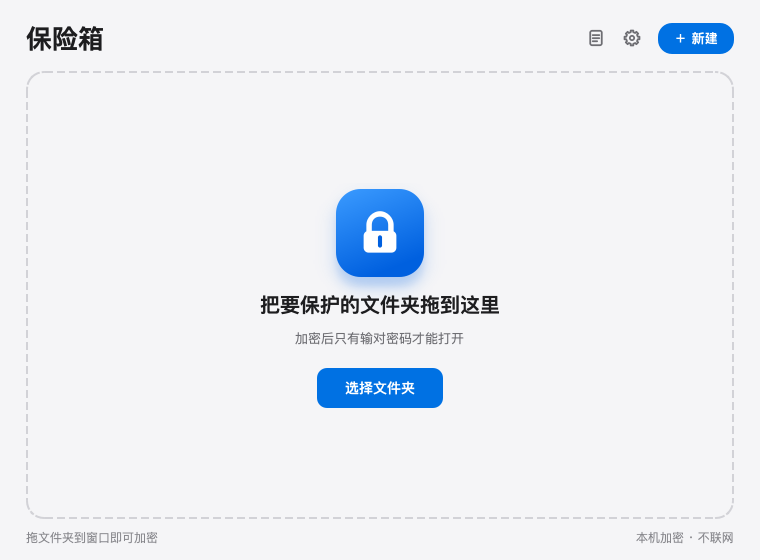
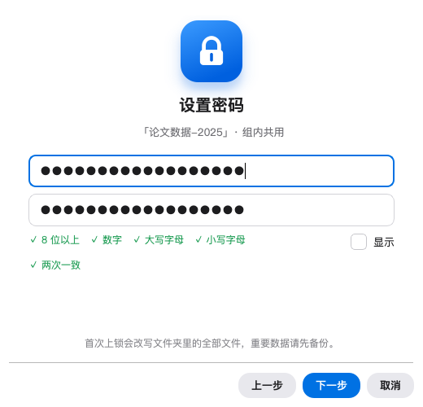
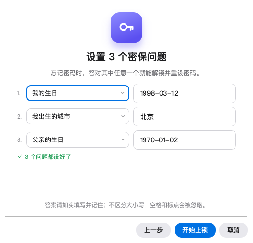
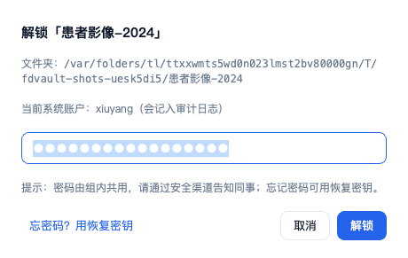
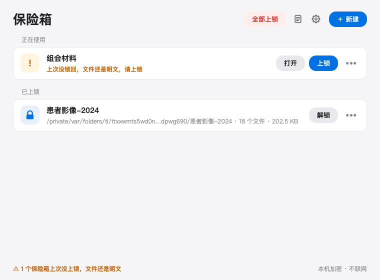
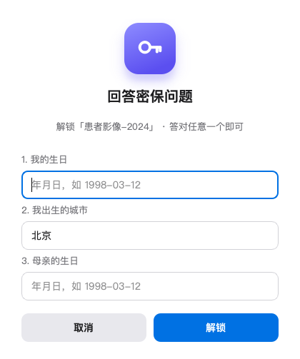
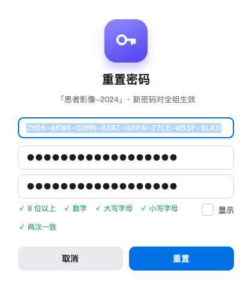
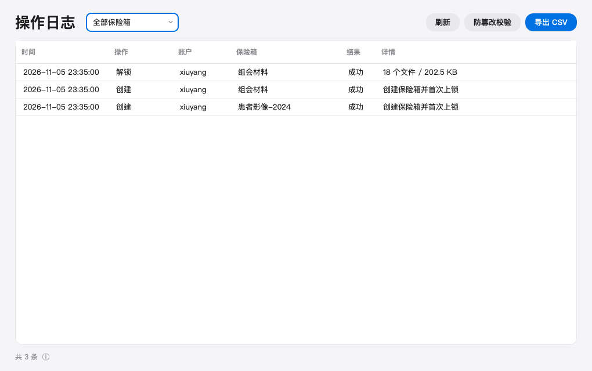

# 文件保险箱 · 使用说明（给组里同事看）

> 一句话：把敏感数据文件夹"锁"起来，锁上后硬盘上只剩加密文件；输密码原地解锁，用完一键锁回。
> 带密保问题（忘密码时答对一个就能找回）和操作日志（谁什么时候解锁过）。

适用：组里共用的 Windows 电脑和 Mac。**每人一个系统账户**，不要多人共用一个账户。

---

## 1. 安装

- **Windows**：看 [installers/windows/安装说明.md](../installers/windows/安装说明.md)
- **macOS**：看 [installers/macos/安装说明.md](../installers/macos/安装说明.md)

两句话版本：

- Windows：解压后双击 `文件保险箱.exe`；首次会被 SmartScreen 拦，点"更多信息 → 仍要运行"。
  装完建议先右键 `验收自检.ps1` →"使用 PowerShell 运行"，自动检查一遍并生成 `验收结果.txt`。
- macOS：双击 `.dmg`，把 `文件保险箱.app` 拖进"应用程序"（或者解压 `.zip` 后拖过去）；
  首次右键 → 打开（没有签名，属于正常现象）。

想在访达右键菜单里直接"用文件保险箱上锁"：双击 `installers/macos/安装快速操作.command`
（装完右键文件夹 → 快速操作）。

---

## 2. 第一次建保险箱（只做一次）

1. **把文件夹拖进程序窗口**（或点右上角 **＋ 新建** 选文件夹；也可以先选一个小文件夹练习）。
   > **重要：先自己备份一份！** 上锁会替换原文件夹里的文件，虽然有断电保护，但备份是最稳的。
2. **设密码**：**任意 6 位数字**（例如 `246810`）；组内共用，程序不保存。
   密码框只能输数字，下面的 `○ 6 位 ○ 纯数字` 会随输入变成 ✓；勾“显示”可以核对有没有打错。
3. **设 3 个密保问题**：每行从下拉框选一个问题、填上答案，三个问题不能重复。可选的问题有：
   我的生日、我出生的城市、父亲的生日、母亲的生日、配偶 / 伴侣的生日、父亲 / 母亲出生的城市、
   我就读的小学、我小时候的小名、我第一只宠物的名字。
   - 生日按 年-月-日 填（`1998-03-12`、`1998/3/12`、`1998年3月12日`、`19980312` 都行，以后答哪种写法都认）；
   - 城市写不写「市」都行（北京 = 北京市）；所有答案不分大小写，空格和标点会被忽略。
   三个都填好、下面出现「✓ 3 个问题都设好了」后，点 **开始上锁**。
   **每新建一个保险箱都要设一次**，各保险箱的密保互不影响。
4. 等进度条走完。文件夹里会只剩：
   - `.vault/`（加密后的数据，别动它）
   - `如何解锁.txt`（给不知道的人看的说明）

> 拖进来的如果**已经是保险箱**（比如同事建的、或之前从列表移除过的），会直接加进列表，不会重新加密。

---

## 3. 日常使用

### 解锁（用的时候）

1. 打开程序，点保险箱那一行的 **解锁**（或双击那一行）；
2. 输密码，回车。输错了会直接提示「密码不对」让你重输；
3. 等进度条走完，文件夹自动在访达/资源管理器里打开，可以正常打开、编辑、另存为。

> 解锁期间文件是明文：**不要在这时候让电脑离开视线**，用完记得锁回。

### 上锁（用完）

- 点那一行的 **上锁**；
- 或者点窗口右上角 / 菜单栏图标里的 **全部上锁**（快捷键 Ctrl+L，Mac 上是 ⌘L）；
- 或者等 **15 分钟** 没人动电脑，自动上锁。列表里会显示倒计时。

**每个文件夹可以设不同的自动上锁时间**：

- 单独设某一个：解锁后点那一行倒计时旁边的 **改时间**（或直接点倒计时），或者 **••• → 自动上锁时间**（锁着的时候也能设）。
  比如「患者数据」5 分钟、「组会材料」2 小时；
- 没单独设的保险箱都 **跟随默认**，默认时间在右上角 **⚙ 设置** 里改（出厂 15 分钟）；想让某个改回默认，在它的菜单里选「跟随默认」；
- 可选 1 分钟到 8 小时，也可以选 **「从不（只在退出时上锁）」**——这时解锁后一直是明文，
  直到你手动上锁、退出程序或关机（这几种情况照样会先锁回）；
- 鼠标停在那一行上，会显示它现在用的是几分钟、是不是跟随默认。

上锁后整个文件夹**不能移动、改名、删除**（防止手滑把密文拖走或删掉）：

- Mac：访达里显示「已锁定」，拖动/删除会被拒绝；就算点了「仍要移到废纸篓」，也还要输管理员密码；
- Windows：资源管理器里移动/删除会提示「需要权限」。保险箱请放在自己建的文件夹里（如 `D:\数据\保险箱A`），
  不要直接放在盘符根目录（`D:\` 下面）：那里程序没权限加「防挪走」，文件夹整体仍可能被挪动（里面的文件照样删不掉）。

要把保险箱**搬到别处**：先在软件里解锁 → 挪文件夹 → 把新位置拖进窗口 → 上锁。
复制（拷到移动硬盘备份）不受影响。U 盘（exFAT）、网络盘不支持这种保护，上锁照常、只是不防删。

### 关窗口 ≠ 退出

- 关窗口默认**缩到菜单栏/托盘**，程序还在后台，自动上锁仍然有效；
- 真要退出：菜单栏图标 → 退出。**退出前程序会自动把解锁中的保险箱锁回去**；
- 如果文件正被 Word/Excel 占着，会上锁失败并提示你。这时选 **「留在后台（继续自动上锁）」**，
  关掉那个软件后点「全部上锁」（不用再输密码）；实在要退出才选「仍然退出（保持明文）」。
- 忘记装了哪个版本：命令行运行 `文件保险箱 --version`（macOS 在 .app 里：`"/Applications/文件保险箱.app/Contents/MacOS/文件保险箱" --version`）。

### 和 CT 脱敏工具一起用（脱敏保密数据再发出去）

常见做法：原始 CT 数据和脱敏映射表都放在保险箱里，要给外面的人发数据时：

1. 在这里**解锁**保险箱；
2. 打开 CT 脱敏工具，原始数据、映射表选保险箱里的；**输出文件夹选在保险箱外面**
   （放在保险箱里的话，锁回时脱敏结果也会被加密，就发不出去了；脱敏工具会提醒）；
3. 脱敏期间，这一行会显示「CT 数据脱敏工具正在使用，用完前不自动上锁」——
   人走开也不会中途上锁；这时点「上锁」也会被拦下，提示等它处理完；
4. 脱敏结束后**锁回**保险箱（人不在的话，到时间会照常自动上锁），把输出文件夹发出去。

建议保险箱选"原始数据"和"映射表"共同的上一级文件夹，一次解锁两样都能用。
如果保险箱是锁着的，脱敏工具会直接拒绝开始，并提示先来这里解锁。

---

## 4. 忘记密码 / 意外中断

### 忘记密码

用 **密保问题**，3 个里**答对任意一个**就行（不会的留空）：

- **只想先打开**：点 **解锁**，在密码框下面点 **忘记密码？** → 回答密保问题 → 直接解锁。
  解锁后会问要不要设个新的 6 位密码（可以点「以后再说」）；
- **想直接换密码**：那一行右边的 **••• → 忘记密码…** → 回答密保问题 + 设新密码 → **重置**。
  旧密码立即失效，**记得把新密码告诉组里同事**。

答错和输错密码一样计次：连续错 5 次后，每次要等 10 秒（最多 60 秒）。

> **旧版本（0.5.x 及以前）建的保险箱**没有密保问题，「忘记密码」仍然是输恢复密钥。
> 建议在 **••• → 设置密保问题…** 里补设 3 个问题；设好后原来的恢复密钥作废。

### 每一行右边的 ••• 菜单

- **在访达中显示**（Windows：在资源管理器中显示）
- **修改密码…**：输原密码 + 新密码；
- **忘记密码…**：答对一个密保问题，设新密码；
- **修改密保问题…**：输当前密码后重新选问题、填答案，旧的问题和答案立即作废（旧版保险箱这里叫「设置密保问题…」）；
- **校验完整性…**（上锁状态）：逐个检查密文有没有损坏或被改；
- **自动上锁时间**：只改这一个保险箱，见上文；
- **解除保险箱（不再加密）…**：这个文件夹以后不想再加密了，就用这个。确认 + 输一次密码（忘了可以答密保）后，
  锁着的会先解锁，然后删掉 `.vault` 和「如何解锁.txt」，文件夹变回普通文件夹，从列表里移除。
  文件都还在，只是变成明文、不再上锁；这个保险箱的密码和密保作废。以后想再加密，重新「＋ 新建」即可；
- **从列表移除**：只是不显示，文件不会删，**也不会解密**（锁着的仍然锁着）；想加回来，把文件夹再拖进窗口即可。

鼠标停在那一行上会显示完整路径、上次是谁解锁的、设了哪 3 个密保问题。

> 密码忘了、3 个密保答案也都想不起来 = 数据打不开。这是加密工具，没有后门。

### 上锁/解锁中途断电、死机、被强杀

不用慌，数据不会半截：

1. 重新打开程序；
2. 那一行会出现在「正在使用」里，图标是橙色感叹号，点 **恢复**；
3. 输密码（忘了就点「忘记密码？」答密保问题），选「接着完成」或「撤销，回到操作前」；
4. 恢复是幂等的，中途再断电也没关系，重新来即可。

---

## 5. 操作日志

主界面右上角的 **日志图标**（📄）：

- 记录每次 创建 / 解锁 / 上锁 / 失败 / 恢复 / 改密码 / 重置密码 / 设置密保问题，以及**是哪个系统账户**做的；
- 可以按保险箱筛选、导出 CSV；
- 点 **防篡改校验**：如果有人手工改了日志，会被发现（哈希链）。
- 鼠标停在左下角「共 N 条 ⓘ」上，可以看到下面这段「半弱审计」说明。

> 审计是"半弱"审计：能发现篡改，但挡不住有管理员权限的人删掉整个日志文件。
> 对组内互相提醒够用，不是法律级取证。

---

## 6. 组内共用约定（建议打印贴在电脑旁）

1. **每人一个 Windows/Mac 账户**，不要共用账户操作保险箱；
2. 密码只在组内口头传；密保答案选**组外人不容易查到**的（生日、出生城市在简历 / 朋友圈里能查到的，尽量换成别的问题）；
3. 解锁后**人走锁屏**（Win+L / Ctrl+Cmd+Q），离开超过几分钟就点上锁；
4. 保险箱里不要放正在用的超大文件（>1 GB），单文件先压一下；
5. 保险箱文件夹**不要**放在 iCloud/OneDrive/坚果云同步目录里；
6. 重要数据在保险箱**外面**再留一份**已经上锁的备份**——上锁后能挡住手滑移动/删除，但挡不住管理员硬删、也挡不住硬盘坏；
7. 换人/重装系统前：先"全部上锁"，再备份整个保险箱文件夹。

---

## 7. 常见问题

| 问题 | 回答 |
|---|---|
| 上锁后别人能看到文件名吗？ | 看不到。文件名也是加密的，`.vault` 里只有一个 uuid 文件名。 |
| 解锁后 Spotlight/Everything 能搜到吗？ | 能。解锁期间就是普通明文文件，系统索引和云同步都可能读到。 |
| 能把整个保险箱拷走吗？ | 能拷走，但没有密码或密保答案打不开。注意 6 位数字密码和生日这类答案都比较好猜：拷走的人慢慢试，几天内可能试出来，所以保险箱别放在别人能随手拷走的地方。 |
| 别人能删掉我的保险箱吗？ | 上锁后普通操作删不掉、移不走（见「上锁」一节）；但电脑管理员硬要删还是能删，U 盘/网络盘上也没有这层保护。所以重要数据仍要有上锁备份。 |
| 上锁后想移动保险箱，提示「已锁定」/「需要权限」？ | 这是有意的保护。先解锁，挪好以后把新位置拖进窗口，再上锁。 |
| 密码有什么要求？ | 正好 6 位数字，别的不要求。旧版本建的保险箱如果还是原来的复杂密码，照样能用；改密码时要换成 6 位数字。 |
| 输错很多次会怎样？ | 密码或密保答案连续错 5 次后，每次要等 10 秒（最多 60 秒）。 |
| 电脑很卡/磁盘不够？ | 上锁和解锁的峰值需要"最大单文件 + 32 MB"额外空间，先清点空间。 |
| 支持几台电脑？ | 同一个保险箱拷到别的电脑，用密码或密保答案都能打开（格式跨平台一致）。 |
| Linux 呢？ | 这版不做 Linux（服务器只跑分析，数据不落服务器）。 |

---

## 8. 截图目录

全部真实界面截图在 [images/gui/](images/gui/)：

| 界面 | 文件 |
|---|---|
| 主界面（已上锁 / 已解锁） | `01-main-locked.png` / `07-main-unlocked.png` |
| 新建向导 4 步 | `02-wizard-folder.png` / `03-wizard-password.png` / `04-wizard-questions.png` / `05-first-lock.png` |
| 忘记密码、改密保 | `14a-forgot-answers.png` / `14-reset-password.png` / `16-security-questions.png` |
| 解锁、上锁进度、恢复 | `06-unlock.png` / `08-progress.png` / `12-recover.png` |
| 审计、设置、托盘菜单 | `11-audit.png` / `13-settings.png` / `09-tray-menu.png` |
| 低磁盘警告、图标 | `01b-main-lowdisk.png` / `00-icons.png` |

---

## 9. 出问题找谁

1. 先看程序日志：
   - macOS：`~/Library/Application Support/组内工具/文件保险箱/gui.log`
   - Windows：`%APPDATA%\组内工具\文件保险箱\gui.log`
2. 把日志最后 20 行和"你做了什么"发给维护的人；
3. **不要**自己删除 `.vault/`，也不要手工改里面的文件——那等于把保险箱拆了。

*2026-11-05 · 密码规则：任意 6 位数字；忘记密码：3 个密保问题答对任意一个；安装包见 dist/SHA256SUMS.txt*

## 遇到问题

先看 [常见问题与报错](常见问题与报错.md)（按屏幕上的原文查）；解决不了再按文末方法收集诊断包发维护者。
