# 文件保险箱 · 需求说明书（v0.2 · 已确认）

> **2026-11-01 已确认（全部按推荐项通过）。本文档作为开发依据。**
> 界面草图已同步更新为「每人一个独立系统账户」版本：解锁页不再手选操作人，审计日志自动记录当前系统账户。
> 配套文件：[界面草图.html](界面草图.html)（浏览器打开，可点击切换）、[images/](images/) 里的截图、[技术方案.md](技术方案.md)（实现细节，可以最后再看）。
> 里面每个数字、每句界面文字、每个流程都可以改。你看完把不对的地方圈出来，我按你的改，然后再开工。

---

## 0. 一句话

把组里一个文件夹用密码**真正加密**成密文；要用的时侯输密码，**原地恢复成普通文件夹**，Word / Excel / 任何软件照常打开；用完一键锁回去，文件夹又变回密文。
**Windows 10/11 + macOS**，2–5 个人共用一台电脑；带**审计日志**和**恢复密钥**。

---

## 1. 我从问答里整理出的需求（请核对有没有理解错）

| # | 方面 | 你的回答 | 我据此确定的设计 |
|---|---|---|---|
| 1 | 为什么需要 | 有敏感数据（患者隐私 / 伦理审查），怕同电脑或共享盘上的同学看到 | 按"内部人能碰到电脑但没有密码"来设计防护 |
| 2 | "上锁"指什么 | **真加密**，没密码绝对打不开 | 不是只读、不是隐藏、不是改权限；磁盘上必须是密文 |
| 3 | 锁什么 | 整个文件夹（含所有子文件夹） | 以文件夹为单位创建"保险箱"，不支持单独锁一个文件 |
| 4 | 打开后什么形态 | 输密码解锁后**原地变普通文件夹**，正常使用；"关掉"以后再打开要重新解密 | 全量原地解密 / 重新加密，不做应用内预览，不做虚拟盘 |
| 5 | 谁用 | 组里 2–5 个人，**共用一个密码** | 不做用户账号体系（二期可加），密码通过当面/口头传递 |
| 6 | 数据放哪 | 本机硬盘（不是共享盘） | 不处理网络盘并发的复杂情况 |
| 7 | 什么系统 | Windows + macOS；Linux 服务器只跑分析、数据不落服务器 | **第一版只做 Windows + macOS**；核心代码保持跨平台，以后加 Linux 命令行很容易 |
| 8 | 电脑账户 | 原来共用系统账户，**已确认改成每人一个系统账户** | 审计日志自动记录系统账户名，可信度提高；共用密码的限制仍在（见风险 2） |
| 9 | 合规要求 | 要加密 + 审计日志（谁、何时、解锁了哪个文件夹） | 审计日志 + CSV 导出；不做防篡改证明 |
| 10 | 忘密码 | 要留一把**恢复密钥** | 创建时生成、只显示一次、强制抄写；可用来解锁和重设密码 |
| 11 | 签名/安装 | 不买证书，能用就行（和现有脱敏工具一样） | 不签名；Windows 首次运行点"仍要运行"，macOS 首次右键"打开" |
| 12 | 磁盘空间 | 很紧（剩不到 10%） | 逐文件流式转换，峰值额外空间 ≈ 2 × 最大单文件（见技术方案 §5）；仍强烈建议先备份 |
| 13 | 数据体量 | 一个文件夹 50–500 GB，文件很多（类似 CT DICOM）；**最大单文件 < 1 GB（已确认）** | 全量解密耗时要如实显示；建议拆小保险箱（见决定 A） |
| 14 | 节奏 | 先给方案和界面草图，确认后再写代码 | 就是现在这一份 |

---

## 2. 已确认的设计决定（2026-11-01 全部确认，可作为开发依据）

| # | 决定 | 理由 | 想改的话 |
|---|---|---|---|
| A | **每个保险箱建议 ≤ 20 GB 左右**，大的数据拆成几个（比如按批次、按患者组） | 原地解密是"全量"的：86 GB 要等 8 分钟，20 GB 约 1–2 分钟。拆小还能把风险限制在一个箱子里 | 可以坚持一个大箱子，但每次要等更久 |
| B | 界面用 **PySide6（Qt）**，中文；安装包约 200 MB | 托盘、进度条、表格、中文字体最稳，后续好维护 | 可以换轻量界面（约 30 MB），但界面会朴素一些 |
| C | 自动上锁：**空闲 15 分钟**、退出软件时、锁屏时（能做的先做） | 共用电脑最大的漏洞是"解锁后人走了"，自动上锁是唯一能兜住的 | 时间可调；也可以只保留手动上锁 |
| D | 首次创建保险箱时，**必须勾选"已经备份"**才能继续 | 会重写整个文件夹，第一次上手前必须有一份档案 | 可以去掉，但我不推荐 |
| E | **不做**"防截图、防转发、限时打开、限制打印" | 在别人的电脑上，这些技术上做不到，做了也是假安全 | 如果你确实要，我们只能换思路（比如数据放在服务器上、自己看，不落地） |
| F | 审计日志记录**系统账户名**（已确认改独立账户）；仍共用密码，所以是"半弱审计" | 独立账户解决"谁在操作"；共用密码决定"谁有权操作"，后者无法证明 | 二期可做每人独立密钥；第一版在界面和导出文件里写清楚局限 |
| G | **不做 Linux 桌面版**（Linux 服务器不存数据） | 少做一套界面和打包，能把 Windows + macOS 做扎实 | 以后需要，可以补一个命令行版 |
| H | 右键菜单放在**最后**做：Windows 用注册表（免费），macOS 用系统"快速操作"代替原生 Finder 扩展 | macOS 原生右键扩展必须买 99 美元/年的开发者账号 | 想要原生右键，就买账号，工期 +1~2 周 |
| I | 不做自动更新，手动发新版本 | 2–5 人，成本不值 | 以后可加 |

---

## 3. 典型场景（一天怎么用）

**S1 · 周一：新建保险箱**
选文件夹 → 看扫描结果（文件数 / 大小 / 最大单文件）→ 设置共用密码 → 生成恢复密钥（抄写、交给导师保管）→ 勾选"已备份" → 开始首次上锁（可以暂停 / 取消回滚）→ 完成。

**S2 · 周二：日常使用**
点托盘图标 → 解锁「某保险箱」→ 输密码（操作人自动记录为当前系统账户）→ 等进度条（86 GB 约 8 分钟）→ 点"打开文件夹"正常干活 → 干完点"立即上锁"，或 15 分钟没动电脑自动上锁。

**S3 · 临时离开**
点托盘"全部上锁"，不用记哪个还开着。

**S4 · 断电 / 强制关机**
重新打开软件 → 弹出"上次上锁没有完成" → 显示每个文件的安全状态 → 选"继续上锁"或"回滚到解锁" → 两种都不会丢数据。

**S5 · 密码忘了**
解锁窗口点"用恢复密钥解锁" → 输恢复密钥 → 解锁成功 → 提示重设密码。

**S6 · 交接给新同学**
新同学拿到软件 + 共用密码即可用；审计日志能看到历史操作。
**注意：** 已经离组的人如果曾经拿到过密码或恢复密钥，只有"改密码 + 重新生成恢复密钥"才能挡住他；如果他已经拷走过数据，那是追不回来的（文档里会写清楚）。

**S7 · 伦理审查 / 导师要材料**
打开审计日志 → 选时间范围 → 导出 CSV → 按敏感文件处理。

**S8 · 备份**
把**已上锁**的文件夹整个拷到移动硬盘（拷的是密文，安全）。

---

## 4. 功能清单

### 4.1 第一版（MVP）必须做

| 功能 | 说明 | 优先级 |
|---|---|---|
| 新建保险箱 | 选文件夹、扫描、设密码、生成恢复密钥、首次上锁 | P0 |
| 解锁 | 密码、进度、暂停、取消并回滚（操作人自动记录当前系统账户） | P0 |
| 上锁 | 手动 / 退出软件 / 空闲自动；进度、取消并回滚 | P0 |
| 保险箱列表 | 状态（已锁 / 已解锁 / 需要处理）、大小、上次操作 | P0 |
| 托盘 / 菜单栏 | 锁状态图标、快捷解锁/上锁、全部上锁、退出 | P0 |
| 断电与异常恢复 | 启动检测、逐文件安全状态、"继续 / 回滚" | P0 |
| 恢复密钥 | 生成、指纹显示、用恢复密钥解锁、重设密码 | P0 |
| 改密码 | 立即生效，不需要重新加密数据 | P0 |
| 审计日志 | 查看、筛选、完整性校验、导出 CSV | P0 |
| 设置 | 自动上锁时间、退出自动上锁、日志保留、恢复密钥管理、删除保险箱 | P0 |
| 数据完整性校验 | "校验"按钮 / `verify` 命令，逐步核对所有文件 | P0 |
| 备份确认 | 首次创建强制勾选 | P0 |
| 命令行 | `lock / unlock / status / verify`，给脚本和以后 Linux 用 | P1 |
| Windows 右键菜单 | 资源管理器右键"上锁 / 解锁"（注册表，免管理员） | P1 |
| macOS 右键 | 用"快速操作"调用命令行（需首次安装一次） | P1 |
| 锁屏 / 休眠时提示上锁 | 能自动上锁更好，至少弹提醒 | P1 |
| 网盘同步目录检测 | 保险箱在 iCloud / OneDrive / 坚果云里时提醒（解锁期间的明文会被同步走） | P1 |

### 4.2 二期可选

- 每人独立账号（每人一把密钥，不用共享密码；但"共享密码"是你们现在选的方案，二期才做）
- 虚拟盘挂载（像 U 盘一样按需读取，解锁不用等全量解密）——要装系统驱动，学校电脑可能拦
- 限时分享 / 导出给外部（加密包 + 一次性口令）
- Linux 命令行版
- 自动更新

### 4.3 明确不做

- 防截图 / 防转发 / 防打印 / 限时失效（DRM）
- 手机 App、云同步、在线协作
- 整盘加密（用系统的 FileVault / BitLocker 更合适）
- 防住有管理员权限或能拆硬盘的人（密码学也防不住，只有加密本身能）

---

## 5. 界面（对应 [界面草图.html](界面草图.html)，可点击体验）

### 5.1 主界面：所有保险箱一眼看清状态

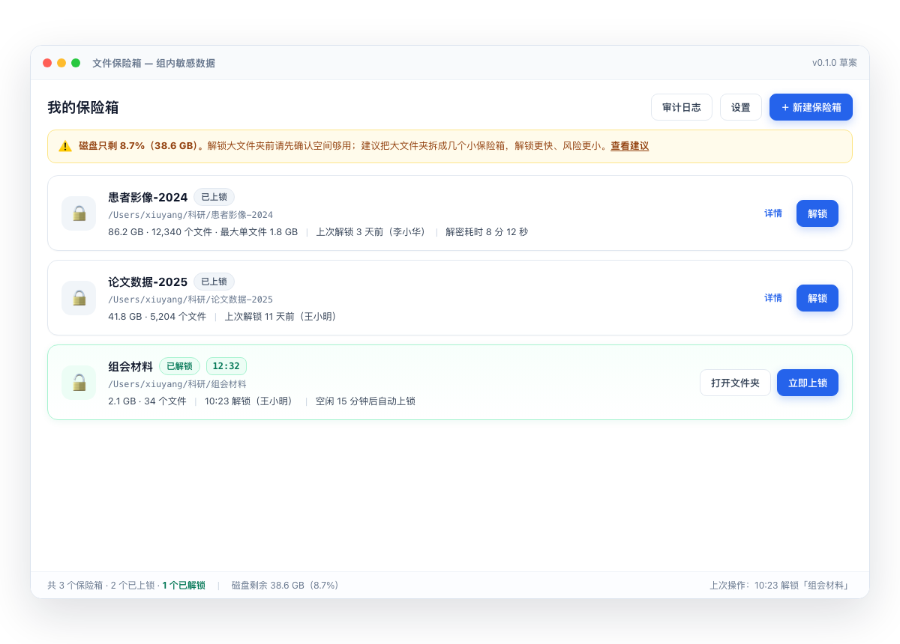

- 已锁的箱子显示 🔒，已解锁的显示 🔓 并带**自动上锁倒计时**。
- 顶部横幅直接告诉你磁盘紧不紧、哪个箱子开着。
- 底部状态栏常驻"磁盘剩余"，避免解锁到一半空间不够。

### 5.2 新建保险箱：三步

| 第一步：选文件夹 | 第二步：设密码 | 第三步：恢复密钥（只显示一次） |
|---|---|---|
| 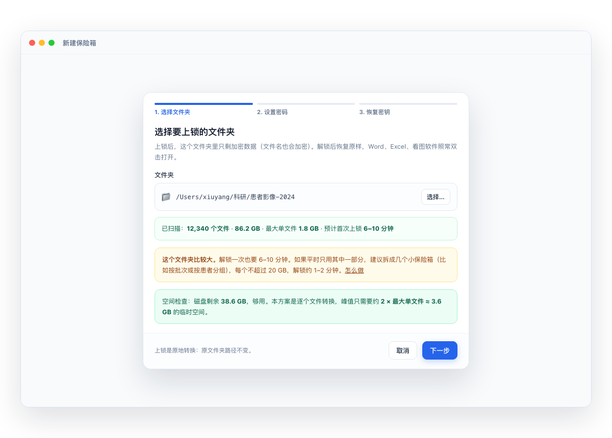 | 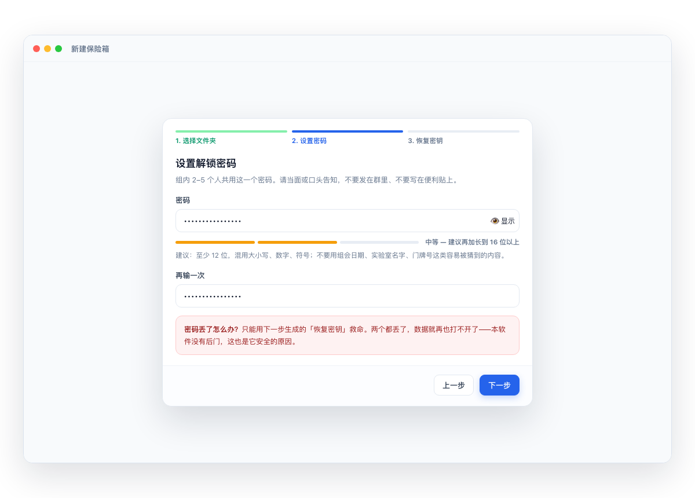 | 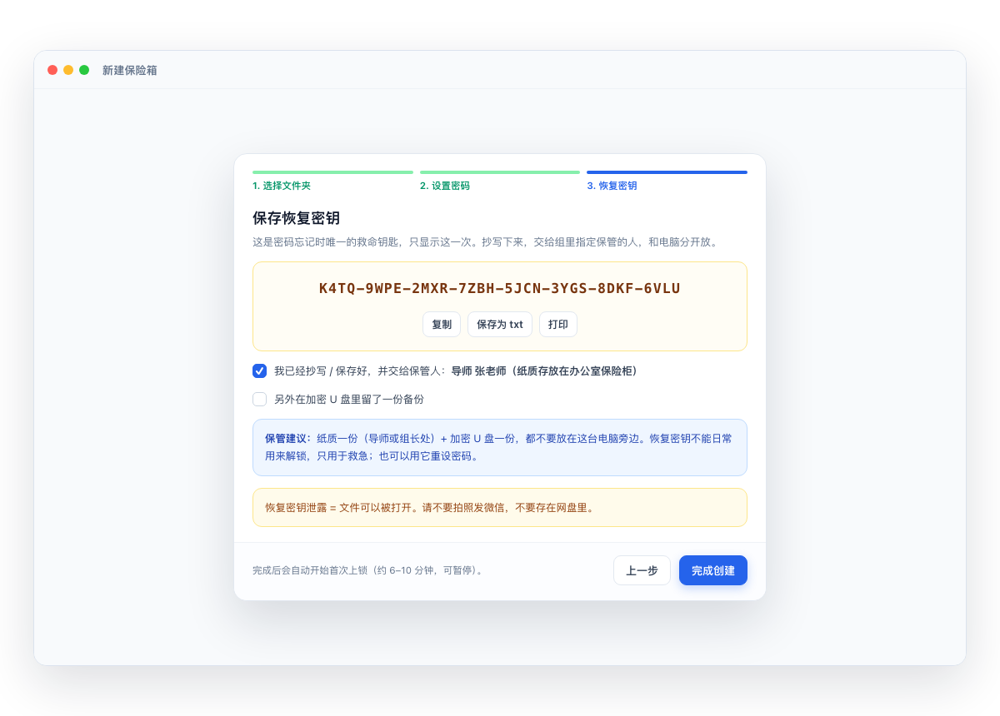 |

- 第一步会先扫描并告诉你：多少文件、多大、最大单文件、预计要多久、磁盘够不够。
- 第二步有密码强度提示；界面明确写"组内共用这个密码，请当面告知"。
- 第三步是**唯一一次**显示恢复密钥；必须抄写 + 勾选交给保管人，才能完成。

### 5.3 首次上锁 / 解锁 / 上锁的进度

| 首次上锁 | 解锁（输密码） | 上锁 |
|---|---|---|
| 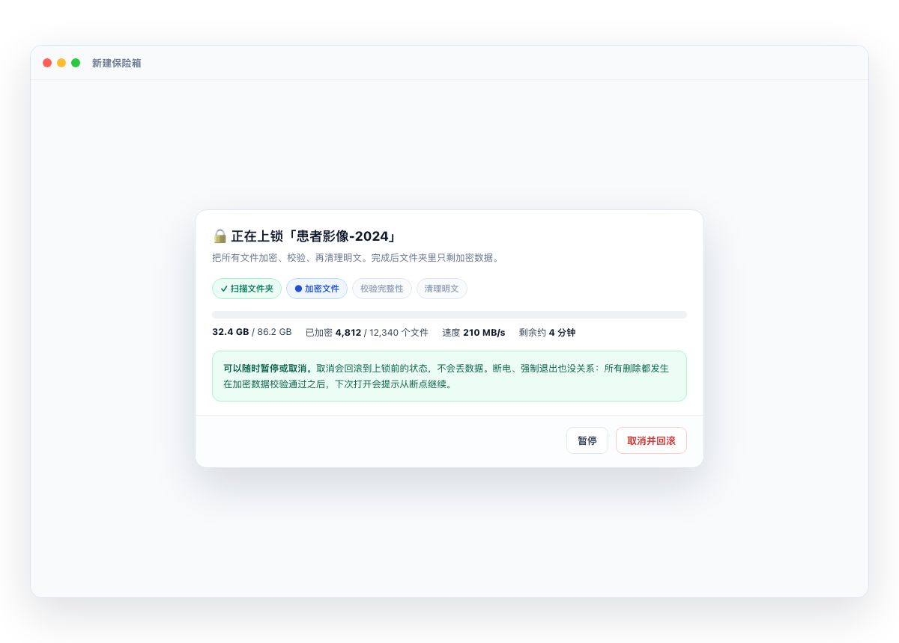 | 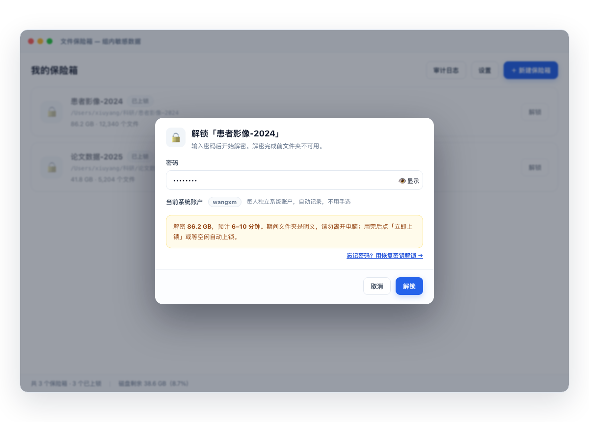 | 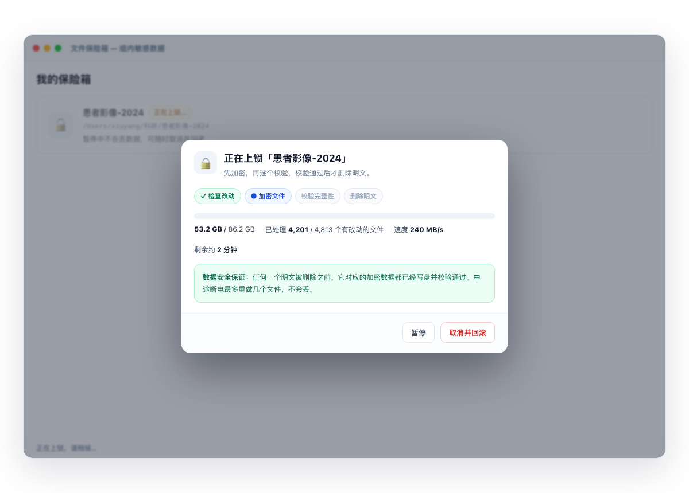 |

- 进度条显示：已处理字节 / 总字节、文件数、速度、剩余时间。
- **随时可以暂停、取消**；取消 = 回滚到操作前状态，不会丢数据。
- 解锁窗口会如实写"约 8 分钟"和"期间是明文，请勿离开"。

### 5.4 已解锁状态：提醒你"现在是明文"

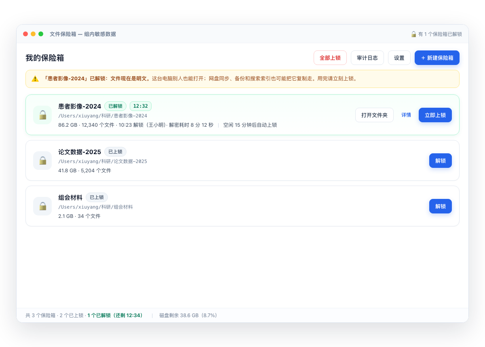

- 醒目横幅 + 托盘图标变 🔓，避免忘记上锁。
- 自动上锁倒计时就在名字旁边。

### 5.5 托盘 / 菜单栏

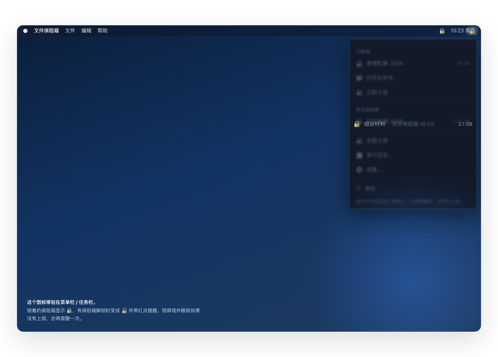

- 锁着的显示 🔒，有箱子解锁时变 🔓 并提醒。
- 支持把文件夹**拖到图标上**直接上锁 / 解锁。

### 5.6 右键菜单（第一版可后补）

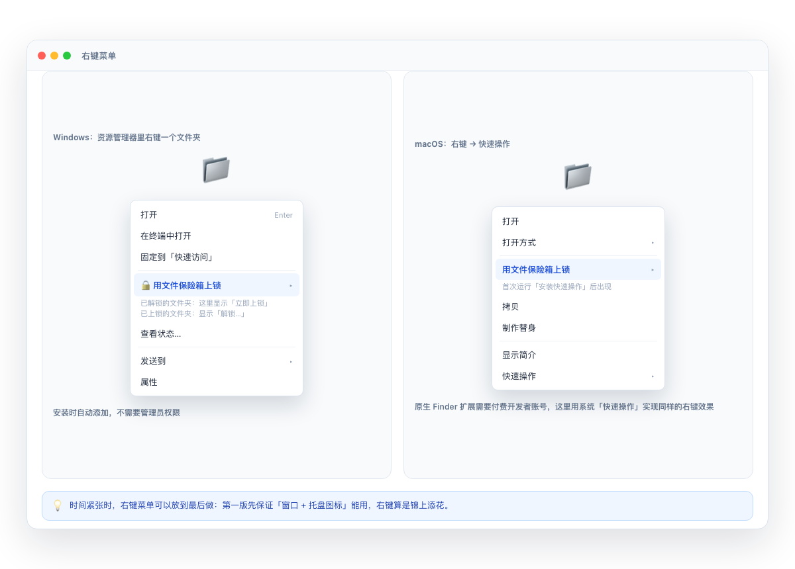

- Windows：安装时自动加注册表项（不需要管理员）；Win11 需要在"显示更多选项"里找。
- macOS：不做原生 Finder 扩展（要 99 美元/年开发者账号），用系统"快速操作"实现同样的右键效果。

### 5.7 审计日志

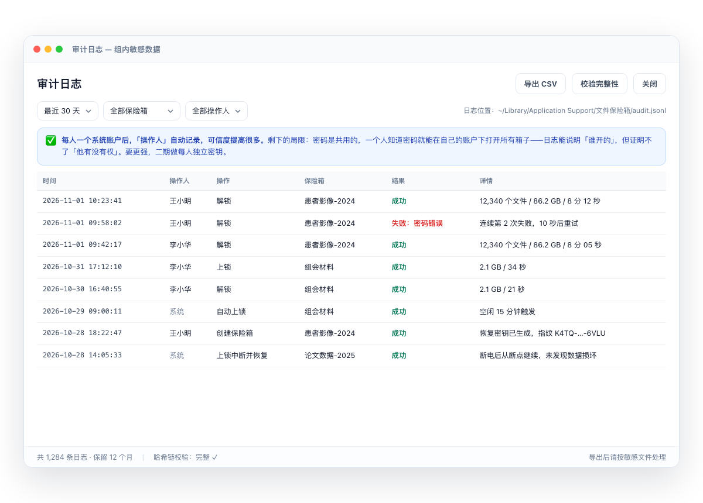

- 记录：时间、操作人（自动取当前系统账户）、操作、保险箱、结果、详情。
- 可以按时间 / 保险箱 / 操作人筛选，导出 CSV。
- 界面明确写着局限：密码是共用的，日志能证明"谁在操作"，不能证明"谁有权操作"。

### 5.8 断电恢复

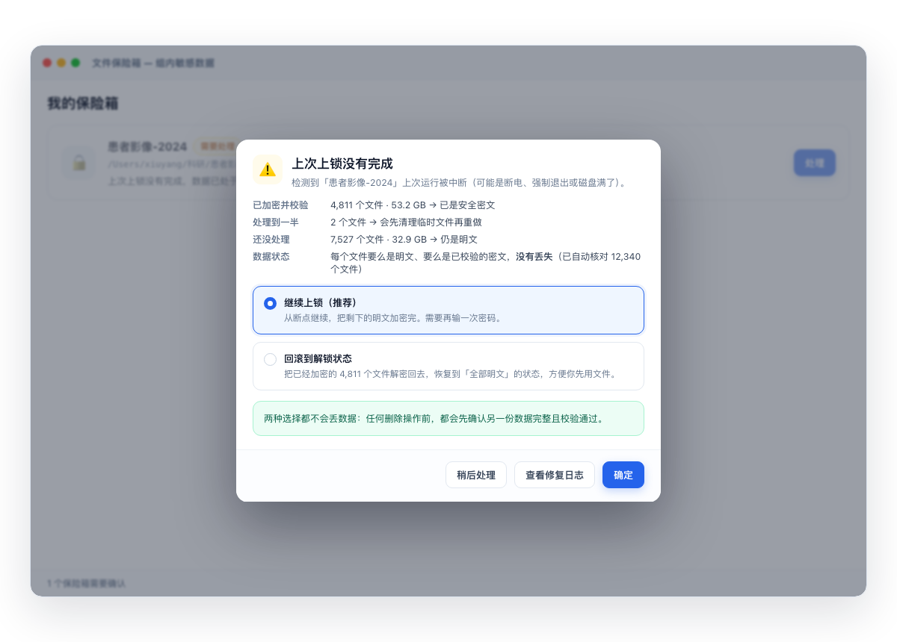

- 显示每个文件现在处于什么状态（已加密并校验 / 处理到一半 / 还没处理）。
- 选"继续"或"回滚"都不会丢数据。

### 5.9 设置

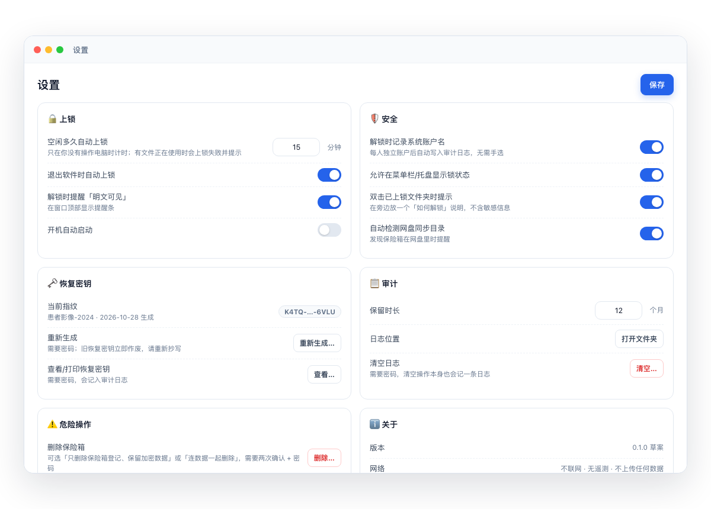

---

## 6. 验收标准（做完后一条条测）

1. 上锁后，文件夹里用任何软件打开任意文件都**读不出内容**；文件名也不出现明文（比如"患者姓名.dcm"这种）。
2. 解锁后，所有文件的 **SHA256 与上锁前逐一相同**，修改时间保留。
3. 在"上锁 / 解锁"过程中随机强制退出、模拟断电 **≥ 50 次**，每次重启后都能恢复到某个安全状态，**0 字节丢失**。
4. 密码输错有延迟限制（比如连续错 5 次后每次等 10 秒），不会让人用脚本暴力猜。
5. 恢复密钥能解锁，并能重设密码；重设后旧密码立即失效。
6. 审计日志正确记录解锁 / 上锁 / 失败 / 恢复；能导出 CSV；手工改一行后"校验完整性"能发现。
7. 磁盘剩不到 10% 时，仍能完成小于峰值的保险箱操作；空间不足时**提前拒绝**并说清楚要多少空间。
8. 中文、空格、emoji、很长路径的文件名都能正确还原；空文件夹也能还原。
9. 正在被 Excel / 看图软件打开的文件，上锁时会中止并提示，而不是强行覆盖。
10. 1 万个小文件（约 10 GB）上锁 + 解锁全流程 < 5 分钟（SSD）。
11. 解锁期间关闭软件 → 自动上锁；下次打开显示"上次未上锁，是否立即上锁"。
12. 连续 100 次解锁/上锁后，磁盘上**找不到**任何明文残留（用已知内容搜索验证）。
13. 每人独立系统账户下，A 账户的保险箱在 B 账户里打不开、也看不到明文（文件权限隔离生效）。

---

## 7. 风险与限制（这部分请一定看）

1. **解锁期间就是明文。** 改成独立系统账户后，别人用自己的账户打不开你的文件夹；但你离开座位时，**别人在你还没锁屏的账户里仍能直接看**。自动上锁 + "离开就锁屏"是唯一的兜底。
2. **审计日志是"半弱审计"。** 独立账户后，"谁在操作"由系统账户自动记录，可信；但密码是共用的，"谁有权操作"证明不了，也挡不住一个同学在自己的账户下打开所有保险箱。适合内部管理和流程说明，**不能当作严格合规证据**。
3. **不签名 = 安装时会有吓人的警告。** Windows 首次要"仍要运行"，macOS 首次要右键"打开"。这和你现在的脱敏工具一样。
4. **磁盘很紧，但已确认最大单文件 < 1 GB。** 峰值额外空间 ≈ 2 × 最大单文件 < 2 GB，空间紧张也能正常跑；软件仍会在开始前检查并给出具体数字。
5. **自研加密软件本身有风险。** 我会用成熟密码库 + 保守设计 + 大量断电/数据一致性测试，而且先在一台电脑上试点一周；但任何自研加密都比不上经过多年审计的成熟工具。建议**同时开启系统的 FileVault / BitLocker**。
6. **系统层面的泄露防不住。** Spotlight 索引、缩略图缓存、最近打开记录、网盘自动同步、备份软件、截图、微信传文件——解锁期间都可能把内容带出去。软件会做能做的（防索引、提醒网盘），剩下的需要习惯配合。
7. **密文可以被别人删掉。** 同事删了 `.vault` 文件夹，数据就没了（他看不到内容，但能破坏）。所以**必须定期把锁着的文件夹备份到移动硬盘**。
8. **恢复密钥的保管责任在人。** 密钥丢了、或者只有一个人知道而这个人联系不上，数据就真没了。建议纸质一份（导师办公室）+ 加密 U 盘一份。

---

## 8. 已确认的决定（2026-11-01）

| # | 问题 | 你的决定 |
|---|---|---|
| 1 | Linux 端 | **不做**（服务器不存数据；核心代码保留跨平台扩展位） |
| 2 | 每人一个系统账户 | **可以改**（安装前由管理员建好账户） |
| 3 | 保险箱拆小（≤ 20 GB） | **确认拆小**（安装向导按文件数和磁盘空间给建议） |
| 4 | 弱审计 | **第一版接受**，界面和导出文件写清楚局限；二期可升级独立密钥 |
| 5 | 最大单文件 | **< 1 GB**（峰值额外空间 < 2 GB，磁盘紧也能过） |
| 6 | Windows 真机 | **组里共用 Windows 电脑**（开发期用 GitHub Actions 自动构建 + 跑测试） |
| 7 | 软件名字 | **暂定「文件保险箱」**，以后可改（只影响显示和安装包名） |

---

## 9. 确认后的计划（里程碑）

| 阶段 | 内容 | 工作量（我执行） | 需要你配合 |
|---|---|---|---|
| M1 | 加密核心 + 命令行 + 断电测试（Mac 上跑通） | 4–6 天 | 无 |
| M2 | Mac 图形界面 + 托盘 + 自动上锁 | 4–6 天 | 抽 10 分钟看一次界面 |
| M3 | Windows 打包 + 自动构建 + 联调 | 3–5 天 | 组里共用 Windows 电脑（已确认可用） |
| M4 | 右键菜单 + 使用说明 + 真实数据小范围试点 | 3–4 天 | 拿一小份脱敏数据试点一周 |

> "天"是工作量估算，不是日历天；中间你确认、测试、我修问题都会占时间。
> 每个阶段结束你都拿到一个能跑的版本，不会等到最后才看到东西。

---

## 10. 附：为什么不用现成的软件

| 现成方案 | 为什么不适合你 |
|---|---|
| 7-Zip / WinRAR 加密压缩包 | 每次用都要解压，用完再打包；解压出来的明文会一直留在硬盘上 |
| BitLocker / FileVault（系统整盘加密） | 防的是"电脑丢了"，防不住"同一个电脑上的同事"；而且开了之后整台机器都要密码 |
| VeraCrypt 加密容器 | 要挂载成虚拟盘，Windows 要管理员装驱动，Mac 要装 macFUSE 并降低系统安全设置；组里同学很难自己搞定 |
| 学校/实验室共享盘自带权限 | 权限挡不住拿到管理员或能拷盘的人；也没有审计日志 |

自研的价值不是"比它们更安全"，而是：**符合你们的流程**（文件夹原地锁、共用一个密码、恢复密钥、审计导出），**零学习成本**（中文界面 + 右键 + 托盘），以及**能按需改**。

---

*文档版本 v0.2 · 2026-11-01 · 需求已确认，作为开发依据*
